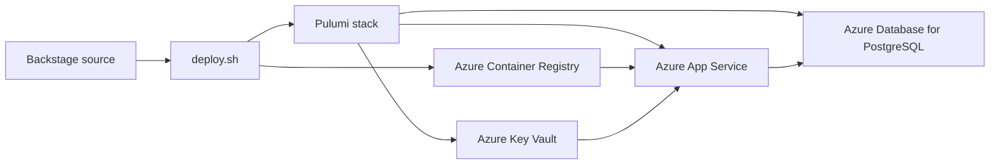

# Backstage on Azure

This repository contains a sample Backstage developer portal and the Pulumi YAML
infrastructure needed to run it on Azure App Service. It includes the Backstage
frontend and backend, Azure DevOps and GitHub integrations, deployment scripts,
and troubleshooting tools for Key Vault access.

This is a demo and it should not be used in production without further changes.

The project was inspired by [Dirk Riehle's Pulumi Backstage Azure
workshop](https://github.com/dirien/pulumi-backstage-azure-workshop), then
adapted and extended for this repository's deployment flow and configuration model.

## Architecture

Pulumi provisions an environment-specific Azure resource group containing:

- An Azure Container Registry for the Backstage image.
- A Linux App Service plan and Web App to run that image.
- Azure Database for PostgreSQL for Backstage's production catalog and plugin
  data.
- Azure Key Vault for credentials, generated database passwords, OAuth secrets,
  and the Tech Radar source URL.
- Application Insights and a Log Analytics workspace for observability.
- A Microsoft Entra application for Microsoft authentication.

The Web App has a system-assigned managed identity. Pulumi grants it the
least-privileged roles required to pull the image from Container Registry and
read secrets from Key Vault. App Service resolves versioned Key Vault
references into environment variables at startup, so the application does not
contain runtime credentials in its image or tracked configuration.

`deploy.sh` builds the Backstage packages and container image, then uses the
Pulumi project in `stacks/` to publish the image and update Azure resources.
`scripts/configure-stack.sh` collects environment-specific inputs and stores
them as Pulumi stack configuration. Stack files are ignored by Git; secret
inputs are encrypted by Pulumi and copied to Key Vault during deployment.



## Prerequisites

- Azure CLI authenticated with `az login`
- Pulumi CLI authenticated with `pulumi login`
- Docker running locally
- Node.js and Yarn versions supported by [package.json](package.json)
- A GitHub OAuth app, GitHub integration token, and Azure DevOps PAT

Any credentials that previously appeared in this repository must be revoked
before publishing a history-free copy.

## Deploy a new environment

Supply credentials as environment variables or omit them to use hidden
interactive prompts:

```sh
export GITHUB_TOKEN='<new GitHub token>'
export AUTH_GITHUB_CLIENT_ID='<GitHub OAuth client ID>'
export AUTH_GITHUB_CLIENT_SECRET='<new GitHub OAuth client secret>'
export GITHUB_ORG='<GitHub organization>'
export AZDO_PAT='<new Azure DevOps PAT>'
export TECH_RADAR_URL='https://dev.azure.com/<organization>/<project>/_git/<repository>?path=%2Ftech-radar.json'
export AZURE_DEVOPS_ORGANIZATION='<organization>'
export AZURE_DEVOPS_PROJECT='<project>'
export AZURE_DEVOPS_REPOSITORY='<repository>'

./deploy.sh \
	--stack kv-test \
	--configure \
	--location uksouth \
	--org-file ./examples/org.local.yaml
```

This creates/selects the Pulumi stack, stores secret inputs as encrypted Pulumi
configuration, creates a new resource group, builds Backstage, and deploys it.
Stack configuration files are ignored by Git.

Use `--resource-group <name>` to choose a resource group, `--preview` to stop
after a Pulumi preview, `--skip-build` when the Backstage bundles are already
current, or `--yes` for non-interactive deployment. Run `./deploy.sh --help` for
all options.

After deployment, set the GitHub OAuth app callback URL to the value printed by
the script:

```text
https://<app-name>.azurewebsites.net/api/auth/github/handler/frame
```

The Microsoft callback is registered automatically on the Entra application.
The generated PostgreSQL password and Entra client secret never need to be
entered manually; Pulumi creates them and stores them in Key Vault.

### Private Organization Catalog

Production User and Group entities are supplied through `--org-file` instead
of being committed to `examples/org.yaml`. Create an ignored file such as
`examples/org.local.yaml` containing the deployment's organization entities:

```yaml
---
apiVersion: backstage.io/v1alpha1
kind: Group
metadata:
	name: platform-team
spec:
	type: team
	children: []
---
apiVersion: backstage.io/v1alpha1
kind: User
metadata:
	name: example-user
	annotations:
		microsoft.com/email: <canonical-entra-upn>
		github.com/user-id: <github-graphql-node-id>
spec:
	profile:
		displayName: Example User
		email: <canonical-entra-upn>
	memberOf: [platform-team]
```

Files ending in `.local.yaml` are ignored by Git. During configuration, the
file is Base64 encoded and stored as an encrypted Pulumi secret. Pulumi copies
it to Key Vault, App Service resolves the versioned Key Vault reference, and
the container writes `/tmp/backstage-org.yaml` before Backstage starts. The
plaintext catalog is therefore absent from the repository and container image.

`CATALOG_ORG_FILE` can provide the file path instead of `--org-file`.

## Troubleshooting Key Vault Access

Grant a user the built-in `Key Vault Secrets Officer` role on the Key Vault for
a deployed stack. The role is scoped to that vault only. For guest Microsoft
accounts, use the sign-in hint to let Azure CLI resolve the canonical Entra UPN:

```sh
./scripts/grant-key-vault-secrets-officer.sh \
	--stack kv-test \
	--login-hint 'name@example.com'
```

To grant access to a known Entra UPN instead, use `--upn`. The script shows the
resolved target and requires confirmation unless `--yes` is supplied.

## Local development

Local Backstage configuration still reads credentials from environment
variables. Set them only in your shell or an ignored `.env` file, then run:

```sh
yarn install --immutable
yarn start
```
